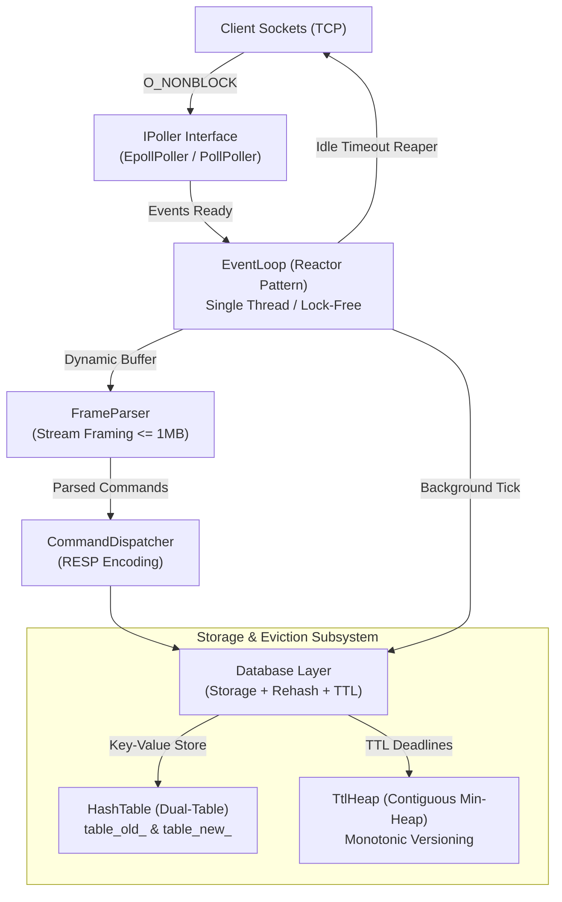
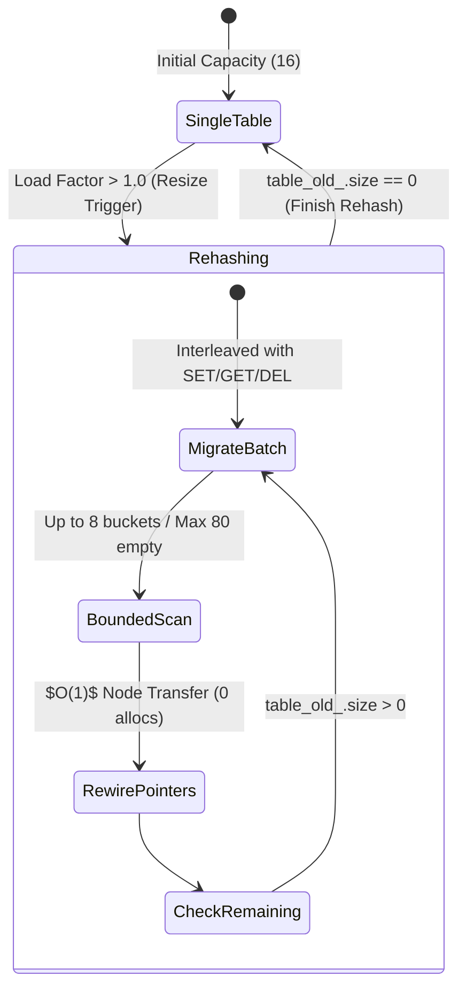

# in-memory-key-value-store (redis_clone)

[](https://github.com/ParjanyaReddy/in-memory-key-value-store/actions)


A high-performance, single-threaded in-memory key-value store engineered in modern C++17 from scratch with zero third-party networking or data structure dependencies.

Implements an `epoll`-driven non-blocking reactor, a streaming length-prefixed wire protocol, a custom separate-chaining hash table with **amortized incremental rehashing**, and a binary min-heap TTL eviction engine with **monotonic versioning**.

---

## The Headline Result: Incremental Rehashing vs Stop-the-World

In a single-threaded database, a naive hash table resize blocks the event loop to migrate all buckets synchronously, introducing severe multi-millisecond latency spikes for all concurrent clients.

Our incremental rehashing engine amortizes table migration across incoming requests and background event loop ticks in bounded steps ($N_{\text{steps}} = 8$ non-empty buckets, max 80 empty bucket visits). When expanding to **1,000,000 keys**, incremental rehashing reduced the peak latency spike from **16.01 ms down to 1.18 ms** (a **13.5x reduction**).


### Latency Distribution at 1,000,000 Keys (Empirical Measurement)

| Metric | Stop-the-World Baseline | Incremental Rehashing (Ours) | Improvement / Reduction |
|---|---|---|---|
| **Max Latency (Peak Spike)** | **16.01 ms** (16,008 &mu;s) | **1.18 ms** (1,180 &mu;s) | **13.54x reduction** |
| **p99.9 Latency** | 17.86 &mu;s | 2.94 &mu;s | **6.07x reduction** |
| **p99 Latency** | 1.23 &mu;s | 0.82 &mu;s | **1.50x reduction** |
| **p50 Latency (Median)** | 0.15 &mu;s | 0.14 &mu;s | **1.04x faster** |
| **Average Latency** | 0.27 &mu;s | 0.19 &mu;s | **1.39x faster** |
| **Total Ingestion Time** | 269.25 ms | 193.57 ms | **28.1% faster overall** |

---

## Architectural Overview



### 1. Single-Threaded Non-Blocking Event Loop
- **Reactor Architecture:** All network I/O, frame parsing, command execution, and table migrations execute deterministically on a single thread. Zero mutexes, zero spinlocks, and zero context switching.
- **Dynamic EPOLLOUT Interest:** Sockets register strictly for `EPOLLIN` by default. `EPOLLOUT` is enabled only when write buffers have pending data, and immediately deregistered once drained, preventing 100% CPU spinning.
- **Portability:** Abstract `IPoller` interface with native Linux `epoll` support (`EpollPoller`) and a portable POSIX `poll` fallback (`PollPoller`).
- **Idle Connection Reaper:** Tracks `CLOCK_MONOTONIC` activity per client; automatically detaches and reaps stale/idle connections to protect system file descriptors (`RLIMIT_NOFILE`).

### 2. Dual-Table Incremental Rehashing

- **Collision Resolution:** Singly-linked list separate chaining with power-of-two capacities (`hash & (capacity - 1)`) using the 64-bit FNV-1a hash algorithm.
- **Concurrent Lookup:** While rehashing is active, lookups inspect `table_new_` first, then fall back to `table_old_`.
- **Zero-Allocation Node Rewiring:** During bucket migration, existing `HashNode*` pointers are rewired directly into the new bucket array without copying strings or reallocating memory.
- **Bounded Empty Bucket Scans:** Capped at 80 empty bucket visits per step ($10 \times N_{\text{steps}}$), preventing latency spikes on sparse hash tables.

### 3. Binary Min-Heap TTL with Monotonic Versioning
```mermaid
flowchart LR
    Write["Write Command<br/>SET key val EX 60"] --> IncrVer["Incr Node Version<br/>node.version = V"]
    IncrVer --> PushHeap["Push Min-Heap<br/>(expire_at_ms, key, V)"]
    
    Tick["Event Loop Tick"] --> PopMin["Inspect Heap Top"]
    PopMin --> Check{"node.version == entry.version<br/>&& now &gt;= expire_at_ms?"}
    Check -->|Match & Expired| Evict["Evict Key Immediately<br/>(Max 100 keys/tick)"]
    Check -->|Mismatch (Stale)| Discard["$O(1)$ Discard Stale Entry<br/>(No Linear Scans)"]
```
- **$O(1)$ Stale-Entry Resolution:** Instead of expensive $O(N)$ linear scans or complex bidirectional heap index maps when keys are overwritten or deleted before expiring, each `HashNode` carries a monotonic 64-bit `expiry_version`. Stale heap entries are popped and discarded in $O(1)$ via a single version comparison.
- **Dual-Layer Expiry:**
  1. *Lazy Expiry:* Checked on every key access (`get`, `set`, `contains`, `ttl`).
  2. *Active Expiry:* Bounded active cleanup loop (max 100 keys per tick) running every event loop cycle.

### 4. Wire Protocol Framing & Pre-Allocation Safety
- **Length-Prefixed Framing:** Every wire frame begins with a 4-byte little-endian length prefix: `[uint32_t payload_len] [payload_bytes]`.
- **Pre-Allocation Ceiling ($\le 1$ MB):** Malicious frames claiming oversized lengths (e.g. 4 GB headers) are rejected *before* allocating buffer memory, preventing denial-of-service OOM crashes.
- **Pipelining & Streaming:** Robust state machine retains partial frames across fragmented socket reads, handling multi-byte splits and multiple batched frames per `read()`.

---

## Empirical Benchmark Results

Hardware: 13th Gen Intel(R) Core(TM) i7-1355U (12 vCPUs) | 7.5 GiB RAM | Linux 6.18.54.1-microsoft-standard-WSL2 | GCC 15.2.0 (`-O3 -DNDEBUG`)

### 1. High-Concurrency Scalability (10,000 Active Connections)
Tested via `tests/integration/test_scalability_10k.py`:
- **Active Concurrent TCP Connections:** **10,000 connections**
- **Peak Server Resident Set Size (RSS):** **5.19 MB** (~544 bytes per connection)
- **Bidirectional Verification:** 100% roundtrip `PING`/`PONG` success under high descriptor load with 0 dropped sockets.

### 2. Memory Footprint vs `std::unordered_map` (1,000,000 Keys)
- **`redis_clone::HashTable`:** **256.34 MB** (**268.80 bytes / key**)
- **`std::unordered_map`:** **256.35 MB** (**268.80 bytes / key**)

### 3. Network Throughput over TCP Loopback (50 Concurrent Clients)
- **Non-Pipelined SET:** **11,257 ops/sec** (p50: 3.80 ms, p99: 13.43 ms)
- **Non-Pipelined GET:** **11,345 ops/sec** (p50: 3.79 ms, p99: 13.49 ms)
- **Pipelined SET (Batch 16):** **15,015 ops/sec** (p50: 3.08 ms, p99: 6.74 ms, max: 8.70 ms)
- **Pipelined GET (Batch 16):** **15,094 ops/sec** (p50: 3.14 ms, p99: 5.87 ms, max: 8.01 ms)

### 4. Safety & Fuzzing Verification
- **LLVM libFuzzer:** **1,000,000 inputs** with zero crashes, hangs, or memory violations (`tests/fuzz/fuzz_frame_parser.cpp`).
- **Valgrind Memcheck:** 34 unit tests (45,949 heap allocs/frees) with **0 errors and 0 bytes leaked**.
- **Sanitizers:** Clean execution under AddressSanitizer and UndefinedBehaviorSanitizer.
- **Oracle Equivalence:** 100,000 randomized operations verified 1:1 against `std::unordered_map`.

---

## Supported Commands

| Command | Syntax | Description |
|---|---|---|
| **`PING`** | `PING [msg]` | Returns `PONG` or echoes `msg` |
| **`SET`** | `SET key val [EX sec] [PX ms]` | Stores key-value with optional expiration |
| **`GET`** | `GET key` | Retrieves value; performs lazy TTL check |
| **`DEL`** | `DEL key [key ...]` | Deletes key(s); returns count deleted |
| **`EXPIRE`** | `EXPIRE key seconds` | Sets key expiration in seconds |
| **`PEXPIRE`**| `PEXPIRE key milliseconds` | Sets key expiration in milliseconds |
| **`TTL`** | `TTL key` | Returns remaining TTL in seconds (-1: no TTL, -2: missing) |
| **`PTTL`** | `PTTL key` | Returns remaining TTL in milliseconds |

---

## Build & Test Instructions

### Prerequisites
- C++17 compliant compiler (GCC 9+, Clang 10+)
- CMake 3.20+
- Python 3.8+ (for integration tests and benchmarks)
- Valgrind & Clang (optional, for sanitizers and fuzzing)

### Quick Start
```bash
# Clone repository
git clone https://github.com/ParjanyaReddy/in-memory-key-value-store.git
cd in-memory-key-value-store

# Build Release binary
cmake -B build -DCMAKE_BUILD_TYPE=Release
cmake --build build -j$(nproc)

# Run 34 unit tests
./build/unit_tests

# Run integration tests
python3 tests/integration/test_server.py

# Run 10,000 connections scalability test
python3 tests/integration/test_scalability_10k.py ./build/redis_clone_server

# Start the server (default port: 6379)
./build/redis_clone_server 6379
```

### Sanitizers & Memory Checking
```bash
# AddressSanitizer + UndefinedBehaviorSanitizer
cmake -B build-san -DENABLE_SANITY=ON
cmake --build build-san
./build-san/unit_tests

# Valgrind Leak Check
valgrind --leak-check=full --show-leak-kinds=all --error-exitcode=1 ./build/unit_tests

# LLVM libFuzzer (Clang required)
cmake -B build-fuzz -DENABLE_FUZZING=ON -DCMAKE_CXX_COMPILER=clang++
cmake --build build-fuzz --target fuzz_frame_parser
./build-fuzz/fuzz_frame_parser -runs=1000000 -max_len=1024
```

### Reproducing Benchmarks
```bash
# Build and run the 1M-key Incremental vs Stop-the-World latency benchmark
cmake --build build -DCMAKE_BUILD_TYPE=Release --target bench_rehash_latency
./build/bench_rehash_latency 1000000

# Generate publication-grade latency chart (requires matplotlib)
python3 bench/plot_latency.py

# Run multi-client throughput benchmark (requires running server)
./build/redis_clone_server 6380 &
python3 bench/load_client.py --port 6380 --clients 50 --requests 100000 --pipeline 16 --command SET
kill %1
```

---

## Documentation & Repository Index

- [docs/WALKTHROUGH.md](docs/WALKTHROUGH.md) &mdash; **5-File Reading Roadmap** and **10-Minute Interview Defense Guide**.
- [docs/RESULTS.md](docs/RESULTS.md) &mdash; Complete empirical benchmark data, hardware specs, and latency percentiles.
- [docs/DESIGN_DECISIONS.md](docs/DESIGN_DECISIONS.md) &mdash; Architectural Decision Records (ADR 001 &ndash; ADR 014).

---

## Architecture Tradeoffs & Limitations

1. **No Persistence (AOF / RDB):** This implementation is strictly in-memory. If the process terminates, data is lost. Adding Append-Only File (AOF) persistence would involve streaming mutating commands to an append buffer and calling `fdatasync()` on background ticks.
2. **Single-Threaded CPU Scaling:** Operating on a single thread prevents locking overhead, but does not utilize multiple processor cores. Scaling beyond a single core requires running multiple instances sharded across ports.
3. **Separate Chaining vs. Flat Arrays:** Linked list nodes introduce an 8-byte pointer overhead per node and pointer indirection overhead, but enable $O(1)$ zero-allocation bucket migration and avoid clustering degradation.

---

## License

MIT License. Designed and engineered for high-performance systems engineering.
